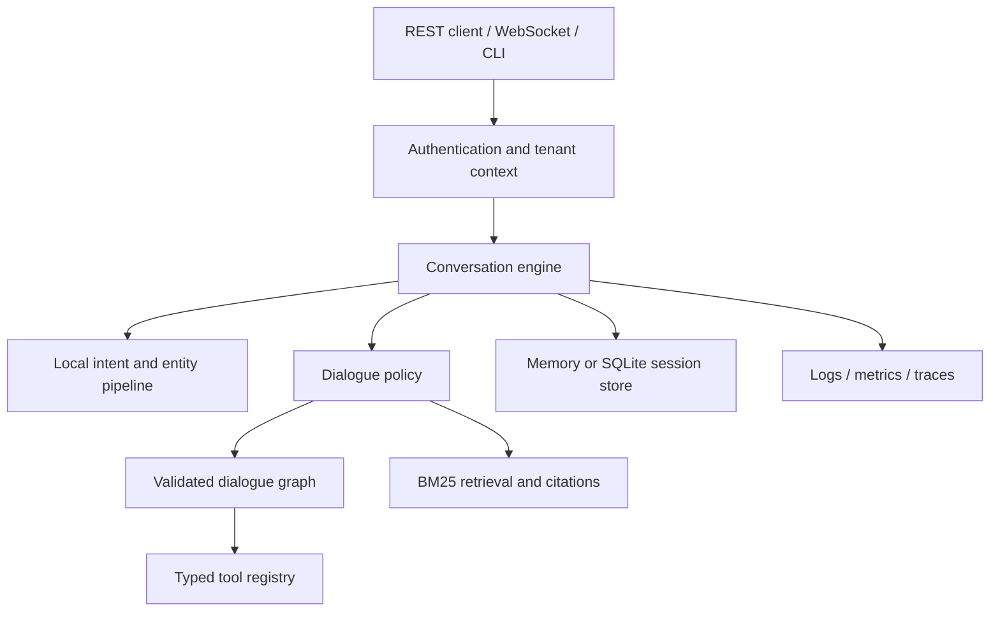

# ConversaFlow AI

### Local intent intelligence. Explicit dialogue flows. One conversational runtime.

[](https://github.com/MrKyaw/ConversaFlow-AI/actions/workflows/ci.yml)
[](pyproject.toml)
[](sdk/typescript/README.md)
[](LICENSE)

ConversaFlow AI is a self-contained conversational AI runtime for multi-turn support workflows. It combines a locally trained intent classifier, validated dialogue graphs, extractive knowledge retrieval, and typed tools behind a tenant-aware FastAPI service.

Build an assistant that can collect missing information, confirm a request, call a business tool, answer from a knowledge base with citations, and signal when a human should take over. The dialogue state, decision paths, and integration boundaries are explicit Python and JSON that you can inspect and extend.

**No external model API is required.** The included business tools are deterministic demonstration backends. Connect and authorize your own business systems before using these workflows with customers.

[Quick start](#quick-start) · [Features](#features) · [Architecture](#architecture) · [API examples](#api-examples) · [Validation](#validation) · [Documentation](#documentation) · [Contributing](#contributing)

## Why ConversaFlow?

Support conversations often need more than a single answer. An order lookup needs an identifier; an address change needs a complete destination and confirmation; an unresolved request needs a controlled handoff. ConversaFlow provides the components for those interactions in one repository.

- **Run locally:** train and serve the bundled intent model without an external inference service.
- **Keep workflows reviewable:** express collection, confirmation, branches, and tool calls as validated JSON graphs.
- **Ground answers in documents:** return retrieved passages and citations rather than generating unsupported answers.
- **Use the same runtime everywhere:** REST, WebSocket, CLI simulation, and evaluation share the engine.
- **Measure behavior:** inspect intent metrics, golden-conversation results, source coverage, and CI evidence independently.

## Features

| Area | Included behavior |
| --- | --- |
| Intent understanding | TF-IDF features, softmax regression, temperature calibration, confidence and ambiguity signals |
| Entity extraction | Typed slots for identifiers, email, phone, dates, times, money, enum values, and more |
| Dialogue management | Multi-turn collection, confirmation, branching, subflows, retries, cancellation, and handoff |
| Knowledge retrieval | Tenant-scoped BM25 search with document citations and a minimum-score policy |
| Tool orchestration | Typed argument validation, registered handlers, async timeouts, and structured results |
| Sessions | Memory or SQLite persistence, TTL, bounded history, and session-scoped response replay |
| Access control | API-key tenant identity and `admin`, `agent`, and `viewer` roles |
| Interfaces | REST endpoints, WebSocket frames, CLI commands, OpenAPI documentation, and a TypeScript client |
| Voice output | Escaped SSML composition and interruption signals |
| Observability | Structured logs, request IDs, tracing data, and Prometheus metrics |
| Delivery | Python package builds, container image, Compose configuration, and GitHub Actions |

### Included workflows

Eight flow definitions are shipped under [`data/flows/`](data/flows/):

| Flow | Example request | Main interaction |
| --- | --- | --- |
| Order status | “Where is my order ORD-1234?” | Collect an order ID and look up shipment status |
| Refund | “I need a refund for my order” | Collect details, confirm, and invoke the sample refund tool |
| Change address | “Change my delivery address” | Collect the order, street address, and city; confirm the change |
| Cancel order | “Cancel my order” | Identify the order and confirm cancellation |
| Book appointment | “Book an appointment” | Collect service, date, and time before confirmation |
| Reschedule appointment | “Move my appointment” | Identify the booking and collect the replacement schedule |
| Cancel appointment | “Cancel my appointment” | Identify the booking and confirm cancellation |
| Technical support | “I need help with a technical issue” | Collect problem details and create a sample support ticket |

Knowledge retrieval covers the bundled FAQ examples, while policy handles greetings, feedback, clarification, and human handoff signals. All included orders, appointments, policies, and company details are demonstration fixtures; see the [dataset notes](data/README.md).

## Quick start

### Requirements

- Python **3.11 or 3.12** for the tested runtime environments.
- Node.js **22+** if you want to build and test the TypeScript SDK.
- Docker with Compose if you choose the container workflow.

Run Python commands from the repository root so the bundled `data/` directory is available.

### Install and run

```sh
git clone https://github.com/MrKyaw/ConversaFlow-AI.git
cd ConversaFlow-AI
python3 -m venv .venv
source .venv/bin/activate
python -m pip install -e '.[dev]'
conversaflow train
conversaflow simulate "hello" "where is my order ORD-1234"
conversaflow serve --host 127.0.0.1
```

On Windows PowerShell, activate with `.venv\Scripts\Activate.ps1`.

Training writes `models/nlu.json`. A runtime with no model artifact can train from the bundled corpus at startup; explicit training makes the artifact available before serving.

With the server running, open:

| Address | Purpose |
| --- | --- |
| [http://127.0.0.1:8000/health](http://127.0.0.1:8000/health) | Public runtime health |
| [http://127.0.0.1:8000/docs](http://127.0.0.1:8000/docs) | Interactive API reference |
| [http://127.0.0.1:8000/redoc](http://127.0.0.1:8000/redoc) | ReDoc reference |
| [http://127.0.0.1:8000/openapi.json](http://127.0.0.1:8000/openapi.json) | Machine-readable HTTP schema |

### Try a conversation

```sh
conversaflow simulate "hello" "where is my order ORD-1234"
```

The bundled demo returns a greeting, then an order-status reply such as:

```text
USER: where is my order ORD-1234
BOT : ORD-1234 has shipped with UPS. The estimated delivery date is 2026-10-26. Is there anything else I can help with?
      intent=check_order_status conf=1.00 flow=order_status
```

The order and delivery date are fixed sample data, not a live shipment lookup. For a longer scripted conversation, run `python scripts/demo.py`.

## Architecture



[`runtime/bootstrap.py`](src/conversaflow/runtime/bootstrap.py) wires the runtime once. The engine coordinates session state, NLU, policy, flow execution, and response construction. Transport handlers authenticate and validate requests before delegating to that engine.

See the [architecture guide](docs/ARCHITECTURE.md) for component boundaries, persistence behavior, and extension points.

## API examples

### Send a turn

For local development, the built-in administrator key is `dev-key-123`. It is intentionally public sample data. Set a shell variable for the following requests:

```sh
export CONVERSAFLOW_API_KEY='dev-key-123'
curl http://127.0.0.1:8000/health
curl -X POST http://127.0.0.1:8000/v1/turns \
  -H 'Content-Type: application/json' \
  -H "X-API-Key: ${CONVERSAFLOW_API_KEY}" \
  -d '{"text":"where is my order ORD-1234"}'
```

The response includes `session_id`, reply text, intent/confidence, dialogue state, citations, handoff information, and trace identifiers. Reuse `session_id` to continue the same conversation:

```sh
curl -X POST http://127.0.0.1:8000/v1/turns \
  -H 'Content-Type: application/json' \
  -H "X-API-Key: ${CONVERSAFLOW_API_KEY}" \
  -d '{"session_id":"<returned-session-id>","text":"thanks","idempotency_key":"request-002"}'
```

An idempotency key replays a cached response within the session. External business integrations need their own idempotency guarantees.

### Choose an interface

| Interface | Use it for |
| --- | --- |
| REST | Turns, sessions, knowledge management, analysis, and planning |
| WebSocket `/v1/stream` | Bidirectional session and turn frames |
| CLI | Local simulation, model training, evaluation, and runtime inspection |
| TypeScript SDK | Typed `createSession`, `turn`, and `health` calls |

The [API reference](docs/API.md) documents roles, routes, error envelopes, and WebSocket frame types. The [SDK guide](sdk/typescript/README.md) provides client examples. Keep administrator keys on a trusted backend rather than embedding them in browser code.

## Configuration

Settings come from the **process environment**. [`.env.example`](.env.example) lists supported settings; a `.env` file is **not loaded automatically** by the Python runtime.

| Setting | Default | Purpose |
| --- | --- | --- |
| `CONVERSAFLOW_API_KEYS` | Public local demo keys | Configure `key:tenant:role` principals |
| `CONVERSAFLOW_STORE` | `sqlite` | Choose `sqlite` or `memory` sessions |
| `CONVERSAFLOW_DB_PATH` | `var/conversaflow.db` | Session database path |
| `CONVERSAFLOW_MODEL_PATH` | `models/nlu.json` | Trained intent model |
| `CONVERSAFLOW_DATA_DIR` | `data` | Flow, corpus, and knowledge directory |
| `CONVERSAFLOW_SESSION_TTL_SECONDS` | `3600` | Session lifetime |
| `CONVERSAFLOW_RATE_LIMIT_PER_MINUTE` | `240` | Per-key HTTP limit within one process |
| `CONVERSAFLOW_INTENT_THRESHOLD` | `0.30` | Low-confidence threshold |

Use your own credentials before exposing the service:

```sh
export CONVERSAFLOW_API_KEYS="${YOUR_PRIVATE_API_KEY}:your-tenant:admin"
conversaflow serve --host 127.0.0.1
```

See [configuration](docs/CONFIGURATION.md) for every setting, accepted values, and reserved adapter options.

## Run with Docker

```sh
export CONVERSAFLOW_API_KEYS="${YOUR_PRIVATE_API_KEY}:your-tenant:admin"
docker compose up --build -d
curl http://127.0.0.1:8000/health
docker compose logs -f conversaflow
```

Compose requires an explicit API-key value, binds the host port to loopback, and persists sessions in a named volume. The image trains its model during the build, runs as an unprivileged user, and includes a health check.

Use a **single application worker**. Knowledge mutations, rate counters, demonstration tools, metrics, and dialogue coordination are process-local; SQLite persists sessions only. See [deployment and operations](docs/DEPLOYMENT.md) for TLS ingress, gateway limits, backups, integration review, and rollback guidance.

## Validation

The initial implementation was validated on Python 3.11 and 3.12, with separate SDK and container jobs. Detailed evidence lives in [test results](docs/TEST_RESULTS.md), [evaluation results](docs/EVALUATION_RESULTS.md), and [GitHub Actions](https://github.com/MrKyaw/ConversaFlow-AI/actions).

| Measurement | Recorded result | Meaning |
| --- | --- | --- |
| Python tests | **171 passed** on each supported version | All collected tests passed in the implementation CI run |
| TypeScript SDK tests | **5 passed** | Request mapping, authentication headers, failures, health, and path encoding |
| Line coverage | **88.10%** | Executable statements exercised by the measured Python run |
| Combined line/branch coverage | **84.25%** | Coverage metric used by the explicit **80%** CI floor |
| Held-out intent accuracy | **68/72 — 94.44%** | Accuracy on the bundled synthetic test corpus |
| Intent macro F1 | **0.9450** | Unweighted mean of per-intent F1 scores |
| Golden conversations | **8/8 successful** | Expected outcomes on the bundled conversation fixtures |
| Container | **Build and HTTP smoke test passed** | Image startup, health, and an authenticated turn verified in CI |

Test pass rate, source coverage, and model accuracy measure different things. These results do not establish performance on customer traffic. CI enforces at least 90% intent accuracy, 90% macro F1, and 100% golden-conversation success on the bundled fixtures.

### Reproduce the checks

```sh
ruff check src tests scripts
ruff format --check src tests scripts
mypy src
python scripts/test_report.py
conversaflow eval --split test --markdown docs/EVALUATION_RESULTS.md
python -m pip install build
python -m build
```

For the TypeScript SDK:

```sh
cd sdk/typescript
npm ci --ignore-scripts
npm run build
npm test
```

The report script exits unsuccessfully on test failures or coverage below its configured floor. The [evaluation guide](docs/EVALUATION.md) explains corpus splits and interpretation.

## Extend the runtime

1. **Add domain examples** to `data/intents/train.jsonl`; maintain independent evaluation and test examples.
2. **Define a workflow** under `data/flows/` using the validated flow schema.
3. **Register tool handlers** through `ToolRegistry.register`, with tenant-aware authorization inside the integration.
4. **Add knowledge documents** under `data/kb/` and replace all sample company policies.
5. **Verify the behavior** with regression tests, golden conversations, and independently labeled domain data.

Prefer asynchronous handlers for network I/O. Async tool calls have timeout enforcement; synchronous handlers run inline. Additional persistence implementations can implement the `SessionStore` protocol.

## Repository map

```text
ConversaFlow-AI/
├── .github/                 # CI, issue forms, and pull request template
├── data/                    # Sample flows, intent corpora, FAQ, golden conversations
├── docs/                    # Architecture, API, deployment, evaluation, test evidence
├── scripts/                 # Demo, HTTP latency probe, test-report generator
├── sdk/typescript/          # Typed fetch client and SDK tests
├── src/conversaflow/
│   ├── agents/              # Tool registry, routing, and planning
│   ├── api/                 # FastAPI, authentication, and HTTP limits
│   ├── dialogue/            # Flow schema, runner, policy, and templates
│   ├── evaluation/          # Intent and conversation evaluation
│   ├── knowledge/           # BM25 retrieval
│   ├── nlu/                 # Training, classification, entities, sentiment
│   ├── observability/       # Logging, metrics, and tracing
│   ├── runtime/             # Composition root, engine, sessions, stores
│   └── voice/               # SSML composition
└── tests/                   # Runtime, API, CLI, persistence, and utility tests
```

## Documentation

| Guide | Contents |
| --- | --- |
| [Architecture](docs/ARCHITECTURE.md) | Components, request lifecycle, extension points, persistence boundaries |
| [API reference](docs/API.md) | Authentication, roles, endpoints, errors, streaming frames |
| [Configuration](docs/CONFIGURATION.md) | Every environment setting and its default |
| [Deployment](docs/DEPLOYMENT.md) | Container setup, operations, backups, release checklist |
| [Development](CONTRIBUTING.md) | Setup, checks, contribution and tagging conventions |
| [Evaluation](docs/EVALUATION.md) | Dataset scope, reproduction commands, interpretation |
| [Evaluation results](docs/EVALUATION_RESULTS.md) | Recorded intent and golden-conversation metrics |
| [Test results](docs/TEST_RESULTS.md) | Measured source and branch coverage |
| [Dataset notes](data/README.md) | Sample-data boundaries and fictional company claims |
| [TypeScript SDK](sdk/typescript/README.md) | Build, use, and test the client |
| [Security policy](SECURITY.md) | Reporting vulnerabilities and deployment boundaries |
| [Changelog](CHANGELOG.md) | Versioned changes |

## Security, privacy, and sample data

The bundled API keys are intentionally public development credentials. Sample order IDs, appointment records, contact strings, addresses, and example-domain URLs support demos and tests. They are not connections to customer systems.

The FAQ corpus describes a fictional company. Statements in those fixtures about SOC 2, GDPR, encryption, pricing, enterprise SSO, native integrations, mobile apps, or service availability are **not certifications, compliance assurances, or implemented capabilities of this repository**.

Keep private keys, production credentials, live transcripts, and customer data out of source control. `.env`, local databases under `var/`, generated model JSON, and development environments are excluded from Git. Review Git commit author metadata as well if you need to keep your email address private.

The built-in log formatters redact recognized email, phone, card-like, and IBAN patterns. Session payloads can still contain user-provided data and are not encrypted by this runtime. Define appropriate retention, access, and backup policies for your deployment. Report vulnerabilities through the [security policy](SECURITY.md).

## Current boundaries

- Business tools are sample in-memory integrations and need replacement before handling real customer operations.
- WhatsApp and Slack are channel labels; provider connectors are not implemented.
- Voice support produces SSML and interruption signals; live transcription and audio synthesis adapters are not wired.
- External LLM integrations, a visual flow-builder UI, enterprise identity management, and distributed coordination are not included.
- Horizontal scaling requires shared knowledge storage, rate limits, coordination, and business-system state.

The project provides a deployable runtime foundation. Production suitability depends on your domain data, integrations, traffic profile, and operational verification.

## Contributing

Bug reports, focused improvements, domain examples, and documentation corrections are welcome. Read [CONTRIBUTING.md](CONTRIBUTING.md) for setup, required checks, commit conventions, and semantic version tags.

Use the issue forms for reproducible defects and proposed improvements. For questions, include your version, environment, expected outcome, and a small redacted example. Never post API keys or customer transcripts in public issues.

## License

Released under the [MIT License](LICENSE). Copyright notices from the original repository are preserved.

---

⭐ Star this repo if you find it useful!

[Report Bug](https://github.com/MrKyaw/ConversaFlow-AI/issues/new?template=bug_report.yml) · [Request Feature](https://github.com/MrKyaw/ConversaFlow-AI/issues/new?template=feature_request.yml) · [Ask Question](https://github.com/MrKyaw/ConversaFlow-AI/issues/new?title=Question%3A%20)
