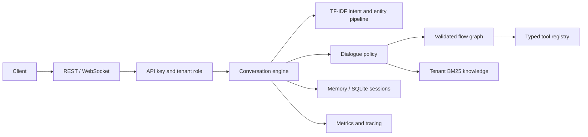

# Architecture

## Request lifecycle

`runtime/bootstrap.py` is the composition root. It loads flow JSON and knowledge JSONL, loads or trains a model, and wires the tools, planner, policy, stores, and engine. The API delegates domain behavior to the engine; the CLI and evaluation harness use the same components.

## Boundaries

| Component | Responsibility | Persistence |
| --- | --- | --- |
| NLU | Sparse TF-IDF, intent probabilities, entity extraction, language and sentiment signals | JSON model artifact |
| Dialogue | Slot collection, confirmation, branching, tool calls, subflows, handoff | Dialogue state inside session |
| Knowledge | Chunked BM25 retrieval and citations per tenant | Startup corpus; runtime changes in memory |
| Tools | Argument validation, async timeouts, deterministic sample integrations | Demo state in memory |
| Sessions | Tenant checks, TTL, bounded history, turn replay | Memory or SQLite WAL |
| Observability | JSON logs, request IDs, counters and trace data | Logs to process output; counters in memory |

Flow graphs validate references, reachability, slot declarations, and node requirements at startup. Conditions use explicit operators rather than Python evaluation. Model training is deterministic for the same corpus and settings. Startup auto-training is convenient locally; pretrain and distribute a reviewed artifact for deployments.

## Extension points

Add a flow JSON under `data/flows/`, training examples under `data/intents/`, and retrieval documents under `data/kb/`. Register real tool handlers through `ToolRegistry.register`; authorize business operations inside your integration using trusted tenant context. Replace `SessionStore` to add another persistence backend.

The included business tools share demonstration state and are not a multi-tenant production backend. Horizontal scaling requires shared coordination, rate limits, knowledge storage, and appropriately isolated business integrations. Sync tool handlers run inline; prefer async handlers for network I/O because timeout enforcement applies to awaitables.
